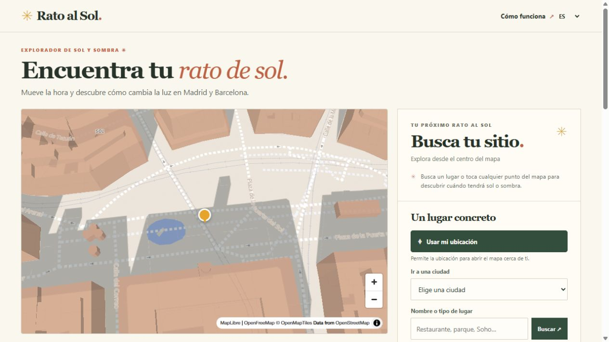
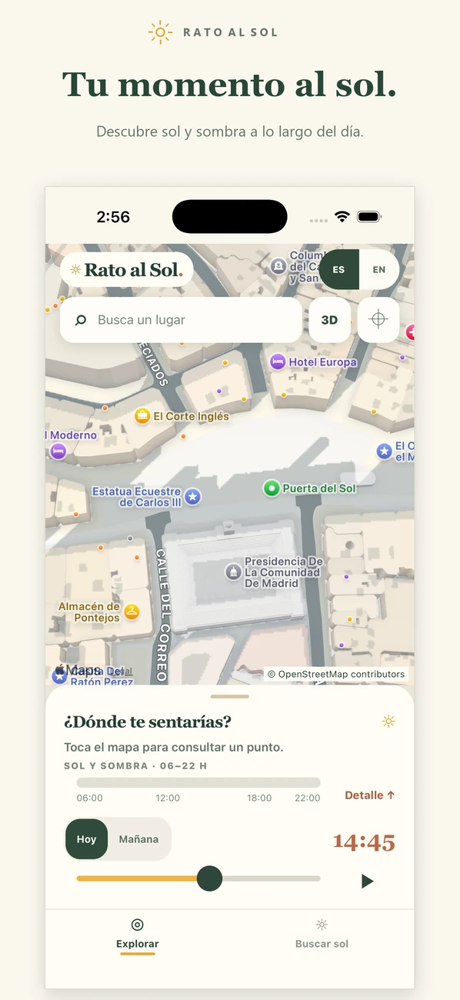
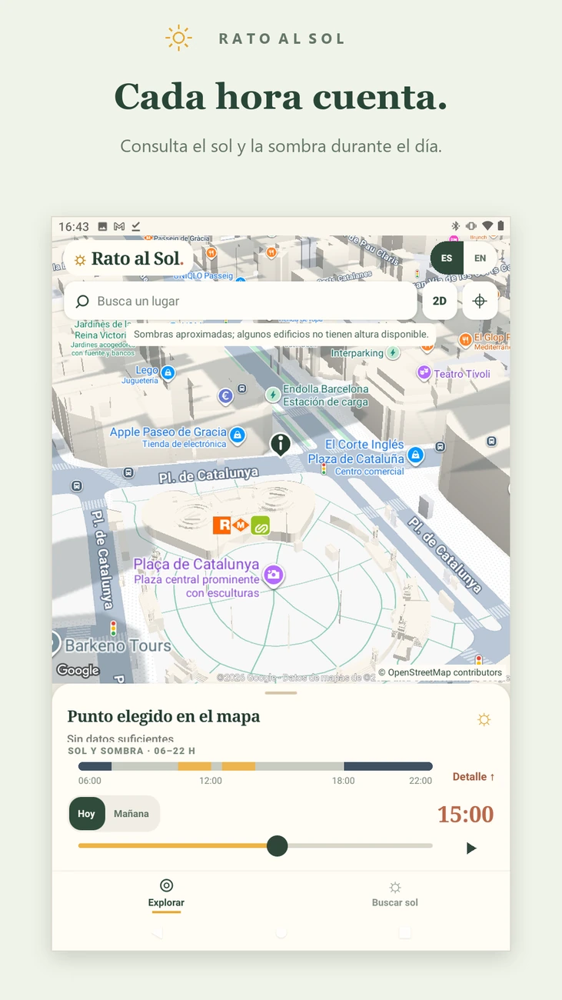
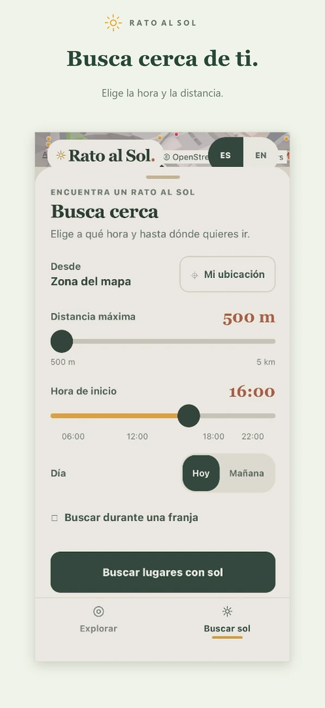

<p align="center">
  
</p>

<h1 align="center">Rato al Sol · Sun Time</h1>

<p align="center">
  <strong>¿Café al sol a las cinco?</strong><br>
  Elige la hora y mira dónde da el sol en Madrid y Barcelona.
</p>

<p align="center">
  <a href="https://tony-r.com/rato-al-sol/"><strong>☀️ Abrir el mapa</strong></a>
  &nbsp;·&nbsp;
  <a href="https://apps.apple.com/es/app/rato-al-sol/id6830366652"><strong>Descargar para iPhone</strong></a>
</p>

[](https://tony-r.com/rato-al-sol/)

<p align="center"><sub>Puerta del Sol, Madrid · 13:40 · Captura de la demo web</sub></p>

En la web, pulsa **Usar mi ubicación** para empezar cerca de ti. Si el navegador tiene permiso, el mapa se centra allí al abrirse. Si no puede localizarte, vuelve a la última zona que consultaste.

## Elige dónde sentarte

1. **Toca un punto del mapa.** Compara dos aceras y consulta sus franjas de sol y sombra.
2. **Mueve la hora o pulsa ▶.** En la web, la reproducción empieza en la hora elegida y vuelve a las 06:00 tras las 22:00.
3. **Busca cerca.** Prueba con las **16:00** y **500 m** para explorar parques y terrazas de la zona.

<p align="center">
  
  
  
</p>

<p align="center"><sub>Madrid en iPhone · Barcelona en Android · Búsqueda por hora y distancia</sub></p>

La captura de Android corresponde a la prueba interna.

> [!NOTE]
> La app estima la sombra de los edificios. Los árboles, los toldos y las nubes pueden cambiar la luz real. Para evaluar una terraza, marca en el mapa el punto donde estarían las mesas.

## Del sol a la sombra dibujada

| Qué resuelve | Dónde verlo |
| --- | --- |
| Calcular la posición del sol con fecha, hora y coordenadas. La web y las apps comparten este motor. | [Posición solar](frontend/solar.mjs) · [Franjas de luz](frontend/shared/estimate.mjs) |
| Proyectar la sombra a partir de la huella y la altura de cada edificio. | [Geometría de sombras](frontend/map-shadows.mjs) |
| Leer los edificios por zona en el móvil y repartir el cálculo de las franjas en tandas para que el mapa siga respondiendo. | [Cobertura local](mobile/src/shadow-coverage.mjs) · [Cálculo en tandas](mobile/src/light-at-task.mjs) |
| Comprobar que la capa local recupera las fachadas de Calàbria y dibuja sombras en distintos puntos de Madrid. | [Pruebas con datos reales](tests/shadow-coverage.test.mjs) |

La web carga los edificios de la zona visible y reutiliza los que ya ha descargado al mover el mapa. La próxima versión móvil lee la misma cobertura desde el dispositivo. En Madrid combina alturas municipales y Catastro. En Barcelona estima alturas a partir del número de plantas de Catastro. [Fuentes y proceso de generación](docs/DATA_SOURCES.md#geometría-de-sombras-incluida-en-ios-y-android--2026-11-11)

## Ejecuta el proyecto en local

<details>
<summary><strong>Web</strong> · Python 3.11+</summary>

Desde la raíz del repositorio, sirve la versión de `web-release/` con este comando.

```bash
python3 -m http.server 5182 --bind 127.0.0.1 --directory web-release/frontend
```

Abre [localhost:5182](http://127.0.0.1:5182/). El mapa y la búsqueda de lugares necesitan conexión.

</details>

<details>
<summary><strong>Móvil</strong> · React Native y Expo</summary>

Usa Node.js 24 y un entorno de desarrollo compatible con el SDK de Expo del proyecto. La app utiliza Apple Maps en iOS y Google Maps en Android.

```bash
cd mobile
npm ci
npx expo start --host localhost
```

</details>

<details>
<summary><strong>Pruebas</strong> · geometría, cobertura y reproducción</summary>

Desde la raíz, después de instalar las dependencias de `mobile/`, ejecuta las comprobaciones.

```bash
node --test tests/*.test.mjs tests/*.test.cjs
python3 -X utf8 scripts/repo_check.py
```

El alcance de las pruebas está en la [guía de calidad](docs/QUALITY.md).

</details>
